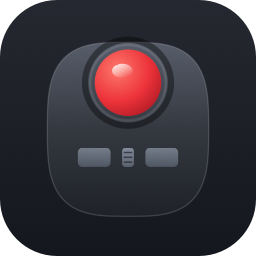
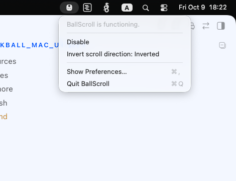
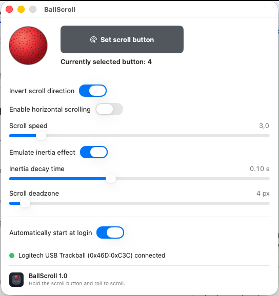

# BallScroll

A tiny native macOS menu-bar app that gives a trackball a scroll wheel —
without a wheel.



**Hold the scroll button, roll the ball, and the focused window scrolls.**
Release and it stops. Everything else about the trackball stays exactly as
Apple shipped it.

> **Platform:** macOS 26+ (Apple Silicon). Built with `swiftc` and the Command
> Line Tools — no Xcode project. Made with **Qwen 3.8 27B 8bit + Hermes Agent**.
> Full design spec lives in [`PRD.md`](PRD.md).

---

## Why this exists

### The problem

My trackball is a **Logitech Marble Mouse / Trackman T-BC21**. It has four
buttons and a ball, but **no scroll wheel** — the physical slot between the two
click buttons is just a groove. On Windows I grew up with `libinput` /
Logitech options doing "hold a button + roll the ball = scroll". On macOS that
mapping doesn't exist out of the box, so for a long time my ball could only
move a cursor and click. Scrolling meant grabbing the trackpad or reaching for
a Magic Mouse.

What I specifically wanted, and what kept missing:

- **Direction invert** — my brain wants to scroll the way a real wheel does.
- **Vertical-only by default** — I mostly want up/down; sideways scrolling is a
  nice opt-in, not the default.
- **Native feel** — low latency, no cursor drift while scrolling, and it must
  *not* interfere with the Magic Mouse or the built-in trackpad I also use.

### What I tried

- **Abnormal Mouse** — the closest thing to what I wanted. It has a
  "move-to-scroll" mode, and honestly this project's scroll engine is modeled
  directly on its `MoveToScroll`. But it's built around the Magic Mouse and
  general pointing devices; getting *my* ball's specific extra button to be the
  trigger, with vertical-only + invert as first-class options, wasn't there.
- **Generic scroll utilities** — they gave me a wheel, but not the direction
  invert I care about, and not a clean vertical-only mode. They also tended to
  treat every pointing device the same way, which fought my coexisting Magic
  Mouse and trackpad.

So I decided to build the narrow thing: **one app, one gesture, my device.**

### The solution

BallScroll is a menu-bar agent. While you **hold the configured "scroll
button"** (a dedicated extra button on the ball — not left/right click), it
converts the ball's movement into real scroll-wheel events and **eats the
original pointer moves**, so your cursor doesn't wander while you scroll.

The key design choice is **device scoping by button number**: only the T-BC21
sends those extra buttons, so a Magic Mouse or trackpad can never accidentally
trigger the gesture. No per-event hardware lookup in the hot path — that's why
it feels native.

When BallScroll is disabled or quit, the trackball behaves **100% natively**.

---

## The gesture, in one picture

| You do | What happens |
|---|---|
| Quick **tap** the scroll button | Nothing (no click leaks through) |
| **Hold** it + roll the ball **up/down** | The focused window scrolls vertically, cursor stays put |
| Roll it **sideways** (only if enabled) | Horizontal scroll |
| Let go while rolling fast | A short **momentum glide**, then a smooth brake to a stop |
| Let go while holding still | Nothing — no movement, no scroll |

---

## What it does

- **Hold-to-scroll** on a dedicated button — vertical by default.
- **Direction invert** (default on, to match my preference), flip it live from
  the menu bar or settings.
- **Optional horizontal scrolling** (off by default).
- **Scroll speed**, a real **momentum/inertia glide** with an adjustable
  decay time, and a **deadzone** to absorb ball wobble / hand tremor.
- **"Set scroll button"** picker with live feedback — the button turns bright
  red for exactly as long as you hold that trackball button, so you can see the
  wiring is right.
- **Launch at login**, a single-instance guard, and sleep/wake recovery.
- Works in the apps you actually use (Safari, Chrome, Finder, Notes, Xcode);
  Magic Mouse and trackpad are completely unaffected.

---

## Screenshots

The app lives in the menu bar as a small trackball icon (the same device, drawn
as a template image so it reads in both light and dark bars) — visible at the
top-left of this dropdown. Clicking it gives you status + quick controls; the
status line tells you exactly what state it's in — *"BallScroll is
functioning."*, *"Trackball not detected"*, or *"Permissions needed…"*:



Full settings in a single window — no tabs. Every row has a hover tooltip:



*(Screenshots are the real running app on macOS 26 / Apple Silicon, with the
T-BC21 connected.)*

---

## Made with AI (and a slow Mac)

This whole project — the PRD, the scroll engine, and this README — was built by
me pairing with **Qwen 3.8 (27B)**, run through **Hermes Agent**, which drove
the terminal, browser and git for me.

It was a slower grind than you'd expect: I wrote and debugged it on a
**Mac Studio (M2 Ultra, 64 GB)** that — for all its cores — turned out to be
pretty slow at the local LLM inference this used. Writing, building and
debugging the app took **three days** in real time.

For the curious, here's what that actually cost in tokens (summed straight from
Hermes' session logs for this repo, across the PRD + implementation + README
sessions):

| Session | Messages | API calls | Input tokens | Output tokens |
|---|--:|--:|--:|--:|
| Write the PRD | 56 | 22 | 1.16 M | 58 K |
| Implement the app from the PRD | 185 | 1,203 | 86.7 M | 1.2 M |
| Rewrite the PRD to match the shipped app | 68 | 25 | 1.68 M | 29 K |
| Write this README (first person) | 88 | 40 | 2.99 M | 29 K |
| **Total** | | | **~92.6 M in** | **~1.3 M out** |

That's **over 93 million tokens processed in total** (~1.3 M of it the model
writing, plus ~882 K of hidden "thinking" tokens) — the input column dominates
because every model call re-sends the whole growing conversation. A lot of that
86 M in the implementation session is context re-reads while iterating on the
scroll engine — which is also exactly why it took three days on this box.

---

## How to use it

### 1. Get the app — just download and run

There are two ways in, in order of least effort:

**Download the built `.app` (easiest).** Grab a `BallScroll.app.zip` from the
Releases page (or I'll hand you the bundle), unzip it, and drag `BallScroll.app`
into **Applications** — then launch it. That's the whole install: no build step,
no signing dance. The app is a ~1 MB self-contained bundle that's already
code-signed, so it runs on any Apple Silicon Mac.

> **First launch:** macOS will warn that this is an app from an
> "unidentified developer" (it's signed with a local cert, not notarized by
> Apple). That's normal for a small app like this — **right-click the app → Open
> → confirm** once, and it runs from then on. It will *not* update silently or
> phone home; nothing is bundled with it but the binary, its icon and the plist.

**…or build from source** (if you'd rather compile it yourself):

```bash
./build.sh
```

Then open the app:

```bash
open -a BallScroll        # or double-click /Applications/BallScroll.app
```

If you don't have the `BallScroll Development` signing identity yet, run it once
to generate one (keeps macOS permissions stable across rebuilds — see the note
under **Building**):

```bash
openssl req -x509 -newkey rsa:2048 -nodes -days 3650 \
  -keyout bsdev.key.pem -out bsdev.crt -subj "/CN=BallScroll Development"
openssl pkcs12 -export -out bsdev.p12 -inkey bsdev.key.pem -in bsdev.crt
security import bsdev.p12 -k ~/Library/Keychains/login.keychain-db
```

> Don't run the app from `build/` while an `/Applications` copy is installed —
> two instances with the same bundle ID will fight over the same events.

### 2. Grant two permissions

On first launch macOS asks for both (and the app re-checks itself until they're
granted — a menu-bar-only app doesn't reliably get "app became active" hooks,
so it polls):

| Permission | Why the app needs it |
|---|---|
| **Accessibility** | To install the event tap that reads/converts your ball's moves. |
| **Input Monitoring** | To see the trackball is plugged in and to probe its buttons. |

If a prompt was dismissed, open it from the settings window — each missing
permission shows an **"Open System Settings…"** button that deep-links to the
right pane.

### 3. Pick your scroll button (first run)

In **Settings → "Set scroll button"**: click the big button, then press on the
trackball the extra button you want to use for scrolling. It turns **bright red**
while that button is held, then the label confirms e.g. `Scroll button set — Button 4`.

That's all you need for a single scroll button. (There's also *Probe all
buttons…* if you want the app to record every physical button, but for hold-to-
scroll one button is enough.)

### 4. Use it

Hold that scroll button and roll the ball. Scroll vertically by default; enable
**"Enable horizontal scrolling"** for sideways rolls to scroll wide pages.

### 5. Tune it (all changes apply live, no restart)

- **Invert scroll direction** — flip if it feels backwards.
- **Scroll speed** (1–20) — how far the page moves per unit of ball rotation.
- **Emulate inertia effect** + **Inertia decay time** — how long the scroll
  coasts after you let go, then brakes smoothly to a stop. Low ≈ stops almost
  instantly; high (up to ~1 s) = a long roll-out.
- **Scroll deadzone** (0–100 px) — ignore tiny wobble before scrolling starts;
  `0` is most responsive.
- **Automatically start at login** — keep it on so the button works from boot.

Every setting persists across app and Mac restarts.

---

## Requirements

- **macOS 26+ on Apple Silicon** (arm64). Developed and verified on a Mac
  Studio M2 Ultra.
- The **Logitech Marble / Trackman T-BC21** trackball (USB).
- Two system permissions: **Accessibility** and **Input Monitoring**.

> The engine keys off the *extra button numbers* that this trackball sends, so
> it's scoped to this device. A different ball with the same button layout will
> very likely work; a different one won't trigger by default.

---

## Building from source

No Xcode needed — `build.sh` compiles everything with `xcrun swiftc` and
hand-assembles the `.app`:

```bash
./build.sh   # compile → bundle → sign (stable identity, ad-hoc fallback) → install to /Applications
```

**Why the stable signing identity matters:** macOS (TCC) binds Accessibility /
Input Monitoring grants to your *code identity*. Ad-hoc signing changes that on
every rebuild, so each build looks like a brand-new app and **silently drops the
grants** — the classic "I already enabled it" churn. The build signs with the
`BallScroll Development` self-signed cert when present and falls back to ad-hoc
only on a fresh machine. If your grants ever go stale:

```bash
tccutil reset Accessibility com.sergey.BallScroll
tccutil reset ListenEvent   com.sergey.BallScroll
```

…then re-grant.

### Project layout

```
Sources/BallScroll/
├── main.swift                 # entry: NSApplication + AppDelegate, app.run()
├── AppDelegate.swift          # menu-bar shell, status item, permission polling, first-run flow
├── BallScrollEngine.swift     # the event tap + state machine + scroll posting + inertia
├── TrackballGate.swift        # IOHID cold path: device presence + button probing
├── AXPermissions.swift        # the two TCC checks / prompts / deep links
├── Settings.swift             # preferences model + defaults + probe logic
├── SettingsWindow.swift       # single-page SwiftUI settings window
└── BallScrollIconRenderer.swift  # shared device drawing (template + color modes)
Resources/                     # Info.plist, app icon (+ generator), iconset
build.sh                       # compile + bundle + sign + install
screenshots/                   # README images
PRD.md                         # full design spec (behavior, constants, pitfalls)
```

---

## Notes & limitations (v1)

- Quick tap on the scroll button does **nothing** by design (no click
  passthrough). The ball's small side buttons don't do back/forward on macOS
  anyway, so nothing is lost by owning that button.
- One global direction invert (not per-axis); vertical-only unless you enable
  horizontal.
- Not a general button remapper — it owns exactly one gesture on this device.

Ideas for later (not yet built): toggle-lock mode, per-app exclusions,
double-tap half-page scroll, modifier-gated horizontal.

---

## License

Licensed under the **MIT License** — see [`LICENSE`](LICENSE). In plain terms:
you're free to use it, copy it, modify it and build on top of it for anything —
personal or commercial. No attribution required (though appreciated). It's given
**as-is, with no warranty**, and I'm not liable if it does anything weird to your
scrolling.

---

Made for my own trackball; the engine's design follows
[Abnormal Mouse](https://github.com/intitni/AbnormalMouseApp)'s `MoveToScroll`,
which proved this exact approach works on macOS.
